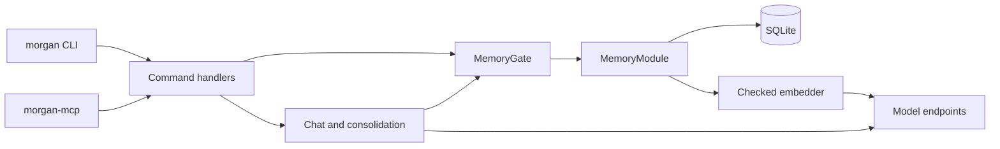

# Architecture

The memory core is one package, `morgan_brain`, with one SQLite file and two surfaces
over one gate. Explicit task, note and owner workflows keep separate execution journals;
finite workers and model guardians may own subprocesses. None installs a service.

See [memory guarantees and reader boundaries](MEMORY_GUARANTEES.md) and the
[reader capability contract](READER_CAPABILITY.md) for the limits of scoped evidence,
current state, provenance, persistence and model-backed claims.

## Components

| Area | Responsibility |
| --- | --- |
| `config.py`, `composition.py` | Resolve surface-specific settings, open the database and construct adapters. Opening does not call a model. |
| `models.py` | Source attribution, project scope, event identity and fact validity models. |
| `memory/gate.py` | Public memory API, scope validation, evidence/inspection and write admission. |
| `memory/module.py` | Atomic capture, fused recall and registered-table erasure. |
| `memory/store/` | SQLite persistence for events, facts, vectors, FTS, entities, history, spaces and projects. |
| `memory/revisions.py`, `memory/evidence.py` | Explicit event lifecycle and scoped source projection. |
| `memory/recall/` | Reciprocal-rank fusion, relevance floor and query-language logging. |
| `memory/checked_embedder.py` | Validate the active embedding fingerprint, fence cache revocation and concurrent initialization. |
| `memory/knowledge/` | Entity extraction, consolidation proposal preparation and guarded fact application. |
| `memory/migrations.py`, `memory/snapshot.py` | Ordered schema changes, verified backups and offline restore. |
| `providers/` | Chat/embedding transport, counted context, structured output and bounded error redaction. |
| `app/chat.py`, `app/chatgpt_import.py` | Atomic chat turns and resumable explicit export import. |
| `surfaces/cli/`, `surfaces/mcp_server.py` | CLI and seven MCP tools over shared command handlers. |
| `tasks.py`, `local_notes*.py`, owner/planning modules | Explicit finite workflows with journals separate from memory. |
| `eval/` | Labelled retrieval and synthetic workflow/model evaluations. |

The detailed implementation constraints are in [AGENTS.md](../AGENTS.md). Public callers
use the gate; model SDK imports stay inside provider adapters. stdout carries CLI JSON or
MCP protocol traffic, and logs go to stderr.

## Capture and source lifecycle

Embedding happens before the write lock. A capture then writes the event, vector, FTS row,
entity index and project registration in one transaction. `BEGIN IMMEDIATE` acquires the lock
before reads; nested writes use savepoints. No model await occurs under that lock.

Stable event IDs make exact replay idempotent. Different content under an existing ID is
refused. Explicit corrections append events with named parents; they do not overwrite source
text. Effective-time eligibility and unresolved forks are shared by retrieval and evidence.
See the [revision contract](REVISION_CLIENT.md) for scope, attribution and compatibility.

Exact evidence and context inspection open an existing database read-only, without migrations
or models. Ranked recall has a different purpose: it finds candidates and does not establish
that an answer is true or that all relevant evidence was retrieved.

## Recall

1. The query is embedded. Vector search returns its top 2k over eligible records in the
   project, or every project with `all_projects`. Explicit revision/effective-time eligibility
   applies inside ranked SQL before candidate limits; no entity-based pool narrows the scope.
2. With `MORGAN_RECALL_FLOOR_MARGIN` set, the floor judges the vector hits alone
   (`recall/floor.py`), before anything else is gathered: recall declines unless the best one
   stands that far above the background the same query pulled up, or an exact entity match
   lands on a memory the vector search ranked in its top k. A decline returns nothing, facts
   included. Fewer than five vector hits are no background to judge against, so they go on
   unjudged. Without a floor, eligible results are returned without that relevance check.
3. FTS5 search returns its top 2k over the same scope, and reciprocal rank fusion merges the
   two rankings. The entity index is not a third: a stored name is in the memory's text,
   which the keyword search already matches.
4. Currently-valid facts for the project are placed first, but budgeted: episodics keep half
   the window whenever they have hits, and the facts that survive a narrow budget are the
   ones the query mentions. Facts fill the whole window only when little else came back.

Recall returns a `RecallOutcome`: the memories, `abstained`, and a `reason`, which the CLI's
`--json`, the MCP result and the `recall.done` log line all carry. An empty result is
abstained, as `empty` (nothing in scope, not even a fact) or `declined` (the floor). Results
come back with `too_few_to_judge`, `no_floor`, or `null` when the floor judged them and they
answered. `keyword_only` is reserved for a keyword-only fallback when embeddings are down,
which does not exist yet; nothing emits it. The `recall.done` line also carries the
embedding's latency and outcome and the query's language.

The fact budget reserves episodic slots when hits exist and `top_k` is at least two.
At `top_k=1` the reservation rounds down to zero, so one fact can fill the only slot.

## The embedding space

`embedding_spaces` records which model wrote the stored vectors: model, width, prefixes, the
vec0 table that holds them, and the fingerprint, the vectors of five fixed strings
(`memory/fingerprint.py`). One space is active. Under the provider backend, opening a writable
database that has none registers the settings' model and width, refusing when the vector table
was created at another width; the hash backend, which no model answers, registers none. An
active space of another width than `MORGAN_EMBEDDING_DIM` is refused on open.

Nothing embeds at open. A process's first embedding call carries the check
(`CheckedEmbedder`): the five strings ride on the request that was being sent anyway, and the
answer is compared with the recorded fingerprint. A model answering outside the tolerance is
`EmbeddingSpaceMismatch`, named, never a silently wrong search, so a model of the same width
is caught like one of another width. While no fingerprint is recorded, the same request
re-embeds a sample of stored memories, and the fingerprint is recorded only when their fresh
vectors match the stored ones. `morgan migrate` makes the same check once its wave has
committed.

## Migrations and snapshots

A database written by an older Morgan is upgraded by numbered steps:

| Step | Kind | What |
| --- | --- | --- |
| 1 | light | re-extract every memory's entities |
| 2 | light | drop the semantic index's tables |
| 3 | light | create `embedding_spaces` and `projects` |
| 4 | heavy | provenance columns on `memories` and `facts`, backfilled |
| 5 | heavy | rename the project `default` to `personal` in every project-keyed table |
| 6 | heavy | rebuild `vec_items` and `fts_memories` with `status`, `scope` and `author_id` |
| 7 | light | seed `projects` with one row per project already named (every write after this registers its own) |
| 8 | light | add event ingestion time without inventing legacy timestamps |
| 9 | light | add fact ingestion time and source-support IDs |
| 10 | light | add the erasure generation used to reject stale prepared writes |
| 11 | light | add explicit event revision parents, roots and the family index |

Steps 1 and 2 are historical exceptions to the light/heavy definition: they predate the split.
Ordinary writable opening runs pending light steps up to the first heavy one. While a heavy
step waits, the gate refuses every write with `DatabaseNeedsMigration`, whose message names the
pending steps and `morgan migrate`; reads work on the schema the database already has.
`morgan migrate` takes a `migrate` snapshot, runs every pending step in one write transaction,
runs `PRAGMA quick_check`, and reports the row counts before and after. A step that fails
rolls the whole wave back, and the snapshot stays.

A snapshot is a `VACUUM INTO` copy of the whole file in `MORGAN_SNAPSHOT_DIR`, named by UTC
time and reason, and `quick_check`ed before it is returned; one that fails the check is
deleted, and Morgan deletes none for any other reason. `morgan snapshot` takes one on demand,
`morgan migrate` and `morgan forget` take one before they change anything, and `morgan restore`
takes a `before-restore` one before it puts a snapshot back. A snapshot newer than this code's
steps is refused. Schema 11 is the current supported version; older writers must not run
against it. Restore requires all processes using the database to stop.

## Consolidation (`morgan consolidate`)

Only eligible active `user_stated` or `tool_observed` sources can support new derived facts.
Preparation records the source/fact basis; application revalidates it under the write lock.
A correction, conflicting update or forget invalidates stale proposals. See the
[preparation-basis contract](decisions/0012-consolidation-preparation-basis.md).

Episodics read through recall, minus those current facts already cover → the model proposes
fact operations as JSON validated against `FactOpBatch` → applied through the gate, in one
write transaction that re-reads the current facts first, so two runs at once see each other's
result. UPDATE closes the old interval and opens a new one (`valid_to`, `superseded_by`);
DELETE closes it; confidence decays with age since last confirmation. `--all-projects` skips a
project whose `projects` row switches consolidation off. It runs when asked, never on a
schedule of its own.

## Erasure (`morgan forget`)

First a `forget` snapshot, the undo. Then one write transaction, holding the lock before the
memory ids are read. It erases:

- memories, FTS rows and entity rows;
- vectors: `vec_meta` and every embedding space's vec0 table, `vec_items` among them;
- facts and session history;
- the project's `projects` row, once no owner has a row left in the project.

It walks `store/tables.py`, the registry of the tables this has to reach, and erases each table
with the deleter its store owns:

- Rows are matched by the memory ids, and by the owner's `user_id` and `project` columns
  wherever a table has both, so an index row whose memory is gone goes too.
- A space's vec0 table other than `vec_items` is matched by those columns alone.
- A registered table with no deleter, or a space's table without those columns, stops it by
  name before anything is erased.
- FTS5's `optimize` then merges `fts_memories`, so the deleted words leave its segments.
- The name-keyed tables go last, so the `projects` row's check sees what the erasure left.

A memory being stored by another process is either entirely erased or entirely kept, because
storing is one transaction too. Tables that were never created on this database are named in
`tables_skipped` rather than counted as zero.

After the commit, it runs `VACUUM`, then `PRAGMA wal_checkpoint(TRUNCATE)`, so the forgotten
words are in neither the database file nor its write-ahead log. A connection in the middle of a
read blocks that checkpoint: the forgotten words then stay in the database file and its log
until a later checkpoint completes, and `forget` logs `forget.wal-not-truncated`, never raises.

[`decisions/0001`](decisions/0001-fact-key-and-forget-reach.md) says what it guarantees.

## Tests (`tests/`)

`unit/` per module; `integration/` runs the CLI as a subprocess, the MCP server over raw stdio
pipes and in-process, cross-process durability, two processes upserting the same vectors or
superseding the same facts at once, a vector delete racing a reinsert, a project erased while
a memory is being stored, two consolidation runs applying the same facts, erasure atomicity and
completeness, migrate and restore through the CLI, the wheel build. Four live tests
(`pytest --live`) need a real embedding model. `pip install -e ".[dev]"` installs exactly what
the suite needs. `tests/fakes.py` holds the scripted chat client and a loopback
OpenAI-compatible server for the probes that need one to answer; nothing in the package exists
only for tests.
